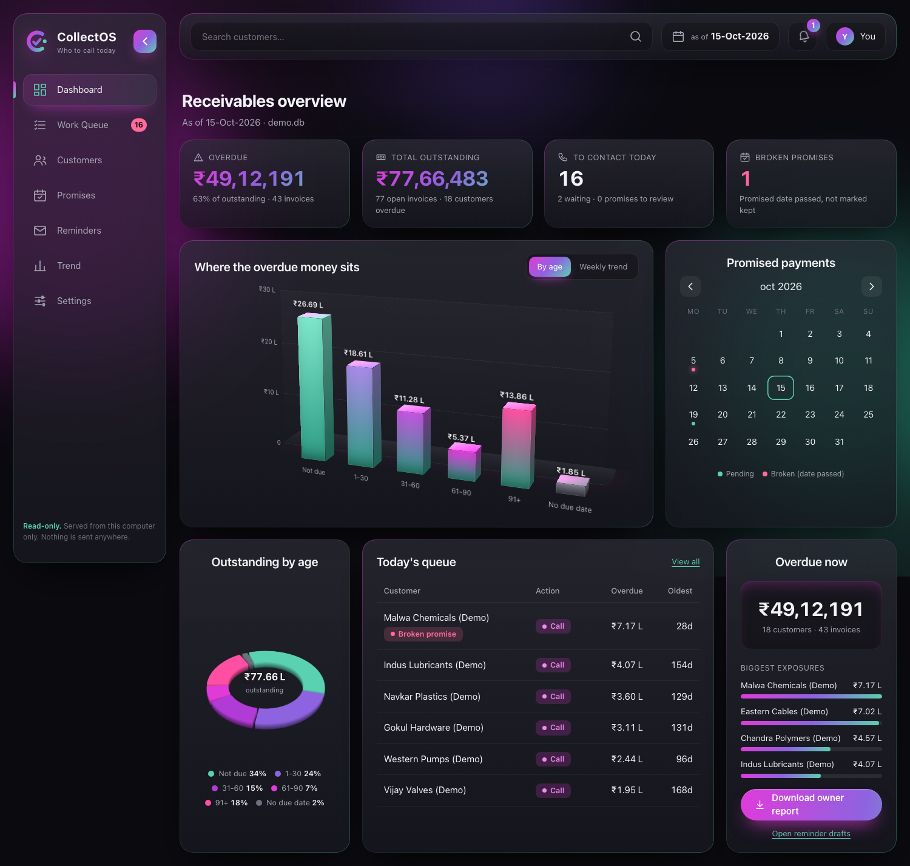

# CollectOS

Local-first receivables toolkit for Indian B2B SMEs. Takes the outstanding-invoice export a
business already has (TallyPrime *Bills Receivable*, Excel, CSV) and produces a prioritised
follow-up list with reasons, a promise-to-pay log, reminder drafts and an owner report.

Codename only; not a registered brand. Status: early build, **not yet validated with real customers**.

## Principles
- Money is `decimal.Decimal` (integer paise in the database), never `float`. Source rows are preserved; changes are audited.
- No cloud, no paid APIs, nothing is ever sent automatically. Reminder drafts are text for a person to review.
- **Never commit real customer data.** Only synthetic data belongs in this repo (`.gitignore` blocks databases and spreadsheets).
- Not suitable for live customer financial data until the security checklist in the strategy plan is met; use synthetic or anonymised data for demos.

## Quickstart
```bash
python3.12 -m venv .venv
.venv/bin/pip install -e ".[dev]"
.venv/bin/pytest                                  # 633 tests

# Build the whole 10-minute demo kit from synthetic data
.venv/bin/collectos demo ./demo-kit
```
`demo-kit/` gets a synthetic invoice CSV, `owner_report.xlsx`, `reminder_drafts.txt` and a demo database.

With a real export (keep it outside the repo or under the git-ignored `data/`):
```bash
collectos import export.xlsx --db data/acme.db            # validates, reports bad rows, saves nothing if errors
collectos queue --db data/acme.db                          # who to chase today, and why
collectos log "Acme Traders" --channel call --outcome "Promised part payment" \
        --promise-date 20-10-2026 --promise-amount 50000 --db data/acme.db
collectos draft "Acme Traders" --sender "Rohit" --company "Sharma Steel" --db data/acme.db
collectos resolve 1 kept --note "NEFT received" --db data/acme.db
collectos snapshot --db data/acme.db                       # day 1 = baseline; repeat weekly after each import
collectos trend --db data/acme.db                          # snapshots side by side
collectos report owner.xlsx --company "Sharma Steel" --db data/acme.db   # adds a Trend sheet once snapshots exist
```

### Dashboard
```bash
collectos demo ./showcase-kit                    # a complete synthetic dataset, incl. contacts, limits and a dispute
collectos ui --db showcase-kit/demo.db           # opens http://127.0.0.1:8765
```


**What it does that a reminder app does not**

| Problem | What the portal does |
|---|---|
| "Is my data right?" (the usual complaint about sync tools) | **Import with a preview.** Drop a CSV/Excel export, see exactly what is new, changed and unchanged, which rows have problems, and how much was paid since last time, *before* anything is saved. Works on the file you already export; nothing to connect. |
| Invoices vanish from an export | They are listed as "may be paid" and only closed when **you confirm** they were paid in full. Nothing is guessed. Confirmed settlements count as payments seen. |
| Who do I call first, and why? | A work queue where every point of the score is a readable reason. Plus an **escalation ladder** (friendly reminder, firm follow-up, owner call, review credit terms) that says which rung and why. |
| "I'll pay Friday" is forgotten | **Promise tracking** with a per-customer record (kept X of Y). Payments arriving after a promise raise a "looks kept" suggestion for you to confirm. |
| Chasing someone who disputes the invoice | **Disputes** keep an invoice out of the chase list, with a category, owner and resolution, but in the totals. |
| WhatsApp is how India collects, but the API costs money | One click opens **your own WhatsApp / mail / phone app** with a drafted message (English or Hinglish) you can edit. You press send, then log it with one click. Nothing is sent by CollectOS. |
| Credit control | Per-customer credit limits, exposure vs limit, a credit-watch list, do-not-contact flags. |
| Did a customer pay? | Upload a bank statement: credits are matched to customers/invoices **as suggestions with reasons** (invoice number, name, exact amount, possible TDS shortfall). It never changes a balance. |
| "Send me the ledger" (the classic stall) | **Statement of account** and a **balance-confirmation letter** per customer: message text plus a downloadable Excel file. Only open items in your data are listed. |
| Making it easy to pay | Your own **UPI id** and a **QR code** in reminders. No payment gateway, no fees: the money goes straight to your account. |
| "Should I offer to waive interest?" | **Interest and waiver offer** at the rate *you* set from your invoice terms: simple interest per invoice, disputed invoices left out, and a draft "pay by this date and we waive it". Wording is for you and your CA to confirm. |
| Selling to someone who already owes | **Can I ship this order?** Dues, credit limit, broken promises and disputes become ship / ship with care / ask for an advance / hold, with the reasons and the rules shown. It never blocks anything. |
| "Will we have the cash for salaries?" | A **cash calendar**: money that actually has a date (customers' own promises and invoices due by terms), week by week, firm vs shaky, against your fixed monthly outgoings. Overdue money with no date is listed separately and never counted. |
| Starting the day | A **morning brief** you can paste into WhatsApp: who to call, promises due, broken promises, payments recorded in the last 24 hours. |
| Away from the screen | A printable **call sheet** with blank columns for what they said. |
| "What changed, and who did it?" | An **activity** feed over an append-only audit log, plus a one-click backup of the whole database. |
| Did it help? | Day-1 baseline and weekly snapshots, shown as a trend. Descriptive only, never claimed as causation. |

Served from your computer only: bound to `127.0.0.1`, Host-header checked, strict Content-Security-Policy, no
external requests, imported text always rendered as text. Writes are a fixed list of POSTs that need a per-run secret
token, a same-origin `Origin`, the right content type and a size cap; uploads sit in a private temp folder under random
names and are deleted after use. `collectos ui --read-only` removes every write control. Respects "reduce motion".
The MSME 45-day flag is informational only and needs your CA's confirmation before you rely on it.

**Optional AI assist (off by default).** Three helpers that use the Claude API, only if you install the add-on
(`pip install -e ".[ai]"`), put a key in a git-ignored `.env` as `ANTHROPIC_API_KEY=...` (`chmod 600 .env`) and
switch it on in Settings. Without all three, nothing leaves the computer.
- **Reply reader**: paste a customer's reply (English/Hindi/Hinglish) and it pre-fills the follow-up form (promise date/amount, dispute). A promise is only accepted if it quotes the customer's own words.
- **Column helper**: for an export CollectOS does not recognise, only the column titles and masked sample cells are sent; or map the columns yourself with no AI at all.
- **Remittance reader**: drop a payment-advice PDF/image; it reads invoice numbers, amounts and TDS, and you confirm each match.

Safeguards: phone numbers, emails, PAN, GSTIN, UPI ids and long numbers are masked before sending; you see a
confirmation of what is sent; the model's answer is treated as untrusted and re-validated; every request is written to
the audit log with the exact text sent; a monthly spend cap (Settings) stops further calls. The default model is
`claude-haiku-5-5` (cheap); set `COLLECTOS_AI_MODEL` to use another. `collectos ai-check` makes one tiny real call to
verify the key, model and response format and prints the cost (never the key). Set `COLLECTOS_NO_DOTENV=1` to ignore `.env`.

`collectos roi-sheet roi.xlsx` writes an editable ROI calculator (live formulas, illustrative defaults) to use with a prospect's own numbers.

**Measured outcomes.** A snapshot records overdue totals, ageing, follow-ups, promises and *payments seen in
data* (increases in recorded paid amounts that arrived via imports since the previous snapshot, read from the
audit log). These numbers are descriptive: they do not prove that follow-up work caused any change, and
invoices that merely disappear from an export are not counted as payments.

## Layers
| # | Layer | Module(s) | Status |
|---|-------|-----------|--------|
| 0 | Scaffold, data-safety `.gitignore` | | done |
| 1 | Decimal money, invoice model, ageing rules (pure, no I/O) | `money`, `models`, `ageing` | done |
| 2 | Import pipeline: CSV/XLSX, header detection, issue report | `importer`, `readers`, `dates` | done |
| 3 | SQLite store, append-only audit log, atomic imports | `store` | done |
| 4 | Work queue with explained scoring; follow-ups and promises | `workqueue`, `store` | done |
| 5 | Reminder drafts and Excel owner report | `reminders`, `report` | done |
| 6 | CLI and deterministic synthetic data | `cli`, `synthetic` | done |
| 7 | Baseline + weekly snapshots, Trend sheet, 5-week synthetic demo history | `store`, `report`, `synthetic` | done |

## Known limitations (read before relying on it)
- **Tally column names are assumptions.** The importer accepts common aliases (Ref. No., Party's Name, Pending Amount, Due on, ...) but has not yet been run against a real TallyPrime export. Do that first.
- If only a *pending/outstanding* column exists, partial payments cannot be detected (the importer warns).
- Invoices absent from a later import are reported but never auto-closed.
- Queue scoring tiers saturate (a customer over ₹1 lakh and 90+ days scores the same as a bigger/older one); amount breaks ties. Tune `QueueRules` with real data.
- Dates read day-first; two-digit years follow Python's pivot.
- No bank/UTR reconciliation, no sending (email/WhatsApp), no multi-user access, no hosted mode. These are deliberately deferred until a customer needs them.
- Credit notes (negative invoices) are rejected for now.
- No encryption at rest beyond what the disk provides (use FileVault/BitLocker).

## Layout
```
src/collectos/   library + CLI          tests/   pytest suite (synthetic data only)
data/            git-ignored workspace  .venv/   local environment
```
